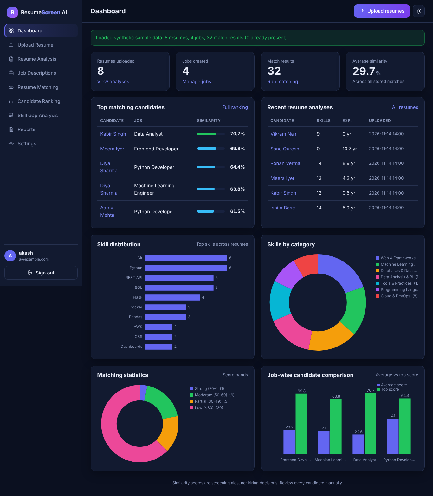
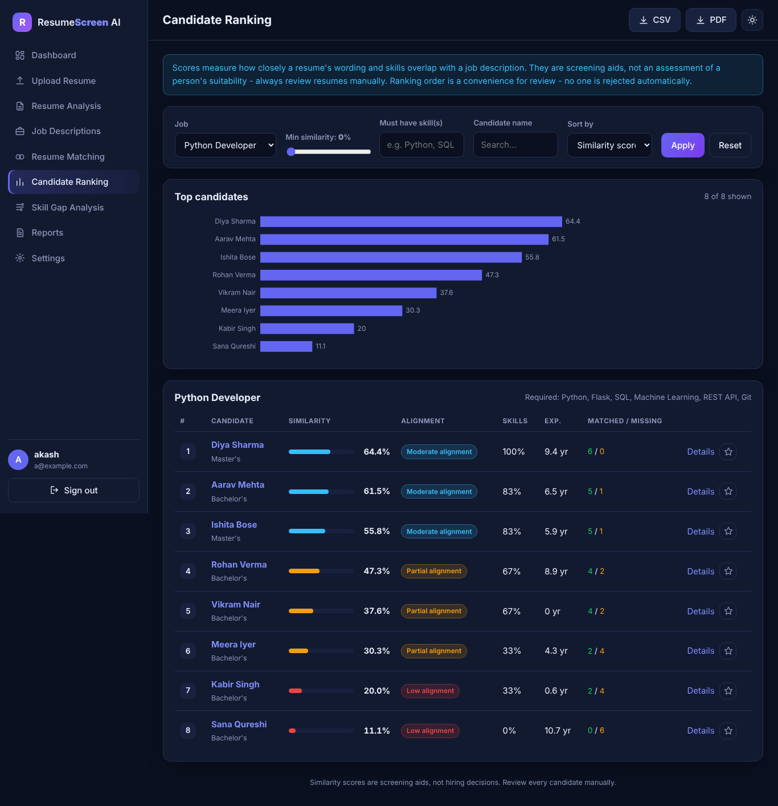

# AI-Powered Resume Screening & Job Matching System

A complete Flask web application that parses PDF/DOCX resumes with NLP, compares them with job
descriptions using **TF-IDF + cosine similarity + skill matching**, ranks candidates, explains every
score, and exports PDF/CSV reports. It runs entirely offline on your own machine (SQLite, no paid APIs).

> **Important:** match scores measure *text similarity* between a resume and a job description. They are
> screening aids, **not** predictions of hiring suitability. The app never rejects anyone automatically,
> labels scores as "alignment" bands, and lets reviewers flag candidates for human review.

| Dashboard | Candidate ranking |
|---|---|
|  |  |

More: [match details](docs/screenshots/match-detail.png) · [light theme](docs/screenshots/dashboard-light.png) · [mobile](docs/screenshots/mobile.png) · [login](docs/screenshots/login.png)

## Features

- **Resume upload** - PDF and DOCX, multiple files, drag & drop, type/size/signature validation, duplicate detection, graceful handling of corrupted, empty or scanned files.
- **NLP analysis** - name, email, phone, education (with degree level), experience (years estimated from date ranges), projects, certifications, ~150 technical skills in 7 categories (aliases normalised), keywords.
- **Job descriptions** - create / edit / delete; title, description, required skills (auto-detected if blank), minimum experience, education.
- **Matching engine** - preprocessing, tokenisation, stop-word removal, TF-IDF (1-2 grams), cosine similarity, skill matching, keyword matching, experience fit. Shows overall %, matching/missing skills, keywords, strengths, gaps, recommendations.
- **Skill-gap analysis** - e.g. required 6, matched 4, missing 2 -> **66.67 %**, with category breakdown and improvement recommendations.
- **Ranking** - descending order, filters (minimum score, required skills, name), sorting, "flag for review" toggle, detailed candidate pages.
- **Dashboard** - totals, average score, top candidates, recent analyses, skill/category distributions, score bands, job-wise comparison (Chart.js). Every number comes from the database.
- **Reports** - candidate PDF, ranking PDF + CSV, all-matching-results CSV (CSV cells are protected against spreadsheet formula injection).
- **UI** - dark/light theme (saved per user), responsive sidebar layout, progress bars, colour-coded skills, animations.
- **Security** - hashed passwords, CSRF tokens, per-user data isolation (every query is scoped by user), uploads stored under random names and served only to their owner, login throttling, open-redirect protection, security headers.
- **Settings** - profile, theme, adjustable score weights, password change, one-click synthetic demo data, workspace reset.

## Technology stack

Python 3.10+, Flask, SQLite, scikit-learn (TF-IDF, cosine similarity), pandas, pypdf, python-docx,
ReportLab, Chart.js, HTML/CSS/JavaScript.

Honest notes on deviations from the original brief:

- **pypdf** is used instead of PyPDF2 (it is PyPDF2's maintained successor; the code falls back to PyPDF2 if present).
- **NLP is a built-in pipeline** (regex tokeniser + scikit-learn stop-word list + domain stop words) instead of NLTK/spaCy, because those need corpus/model downloads and the app must work offline. Skill extraction is rule-based over an editable taxonomy (`modules/skill_extractor.py`).
- **Bootstrap 5 is not used.** It would have to come from a CDN, which breaks the offline requirement, so the interface uses a hand-written responsive stylesheet (`static/css/style.css`).
- **Chart.js** loads from `static/js/vendor/` if you add it, otherwise from the jsDelivr CDN, otherwise a small built-in canvas renderer draws the charts, so charts work with no internet. See "Offline Chart.js" below.

## Architecture

```
resume-screening-system/
├── app.py                  # application factory, CSRF, error handlers, security headers
├── config.py               # settings (paths, limits, default weights)
├── models/                 # schema.py (SQL) + database.py (connections, helpers)
├── modules/
│   ├── resume_parser.py    # validation + PDF/DOCX text extraction
│   ├── nlp_processor.py    # cleaning, tokenising, stop words, keywords
│   ├── skill_extractor.py  # skill taxonomy + matching
│   ├── resume_analyzer.py  # contact info, sections, education, experience
│   ├── matching_engine.py  # TF-IDF, cosine, weighted score, strengths/gaps
│   ├── skill_gap.py        # matched/missing skills + recommendations
│   ├── report_generator.py # PDF (ReportLab) and CSV (pandas)
│   └── services.py         # DB-level operations shared by routes/tests/demo loader
├── routes/                 # auth, dashboard, resumes, jobs, matching, reports, settings
├── templates/ static/      # Jinja pages, CSS, JS
├── sample_data/            # SYNTHETIC resumes (PDF/DOCX) + jobs.json
├── scripts/generate_sample_data.py
├── tests/                  # 73 unit + integration tests
└── uploads/ database/      # created at runtime (git-ignored)
```

Database tables: `users`, `resumes`, `candidates`, `resume_analysis`, `extracted_skills`,
`job_descriptions`, `matching_results` (foreign keys with `ON DELETE CASCADE`).

### How the score works

`overall = Σ weight × component`, over the components that apply to the job:

| Component | Default weight | Meaning |
|---|---|---|
| Required skills | 45 % | share of the job's required skills found in the resume |
| TF-IDF cosine | 30 % | similarity of preprocessed job text vs resume text (IDF fitted on the job + all your resumes) |
| Keywords | 15 % | share of the job's top keywords present in the resume |
| Experience fit | 10 % | estimated years ÷ required years (capped at 100 %) |

If a job has no required skills or no minimum experience, those components are dropped and the rest are
re-normalised. Education is reported but not scored. Weights can be changed in **Settings**. Raw TF-IDF
cosine values are naturally low for long resumes vs short job posts, which is why skills carry the most weight.

## Installation (Windows 11, PowerShell)

```powershell
# 1. Get into the project folder (adjust the path)
cd C:\path\to\resume-screening-system

# 2. Create and activate a virtual environment (Python 3.10+)
py -3 -m venv .venv
.\.venv\Scripts\Activate.ps1
#   If activation is blocked:  Set-ExecutionPolicy -Scope Process -ExecutionPolicy Bypass

# 3. Install dependencies
python -m pip install --upgrade pip
pip install -r requirements.txt

# 4. Create the SQLite database (the app also does this automatically on first start)
flask --app app init-db

# 5. Run the application
python app.py
```

Open <http://127.0.0.1:5000>, register an account, then go to **Settings -> Load sample data** to
import 8 synthetic resumes and 4 job descriptions and see a fully populated dashboard.

### Run the tests

```powershell
python -m unittest discover -s tests -v
```

(`pytest` also works if installed: `pip install pytest; pytest tests`.)

### Regenerate the sample data (optional)

```powershell
python scripts\generate_sample_data.py
```

### Offline Chart.js (optional)

The charts already work offline through the built-in fallback renderer. For the full Chart.js look offline too:

```powershell
Invoke-WebRequest https://cdn.jsdelivr.net/npm/chart.js@4.4.1/dist/chart.umd.min.js -OutFile static\js\vendor\chart.umd.min.js
```

## Example workflow

1. Register / sign in, then **Settings -> Load sample data** (or upload your own resumes on **Upload Resume**).
2. **Resume Analysis** - open a candidate to see extracted contact info, skills, education, experience.
3. **Job Descriptions** - create a job (title, description, skills, experience, education).
4. **Resume Matching** - pick a job and resumes, press *Calculate match scores*.
5. **Candidate Ranking** - filter/sort, open *Details* for the score breakdown, flag candidates for review.
6. **Skill Gap Analysis** - choose a candidate and a job to see matched/missing skills and recommendations.
7. **Reports** - download ranking CSV/PDF, all-results CSV, or an individual candidate PDF.

## Known limitations

- Scanned (image-only) PDFs are not supported - there is no OCR. They are rejected with a clear message.
- Name, section and experience extraction are heuristics; unusual resume layouts can produce wrong or missing fields. Experience years come from date ranges (union, so overlaps are not double-counted) or an explicit "N years of experience" statement.
- Skill detection uses a fixed taxonomy; custom required skills are matched as plain terms. Single-letter languages (C, R, Go) only match through unambiguous aliases (e.g. "R programming", "golang").
- Similarity ≠ suitability: the system cannot see potential, context, or anything not written in the document, and wording differences can lower scores for strong candidates. Review manually; do not auto-reject.
- Login throttling is in-memory (single process). Use `SECRET_KEY` from the environment and a production WSGI server (e.g. waitress) before exposing this beyond localhost.

## Future improvements

OCR for scanned PDFs, spaCy NER and embedding-based (semantic) matching, preferred/nice-to-have skills,
editable skill taxonomy in the UI, bulk job import, email notifications, multi-recruiter teams, Docker image.
